# FinRadar: как собрать единый агрегатор вакансий и возможностей в финансах, экономике и аналитике

Аналитическая записка к коду в этом репозитории: какие источники есть, как к ним подключаться, что с ними делать после сбора и какую аналитику из этого можно получить.

---

## 1. Главное

1. **Единого «окна» на рынок финансовых вакансий не существует, и в 2026 году это особенно заметно.** Крупнейший российский источник, hh.ru, с апреля 2026 года отвечает 403 на анонимные запросы к `GET /vacancies` (по сообщениям Хабра и разработчиков; официального анонса в открытых источниках нет). Ещё раньше, 15.12.2025, закрыт API для соискателей. Поэтому агрегатор нельзя строить «вокруг одного API»: нужен набор разнородных коннекторов с общей моделью данных.
2. **Самые ценные позиции в финансах публикуются вне hh.** Инвестбанкинг, PE/VC, buy-side, Big4 и стратегический консалтинг в России в значительной мере живут в Telegram-каналах сообществ (Perforum, FinExecutive, отраслевые каналы) и на нишевых сайтах. В мире то же самое происходит на карьерных сайтах работодателей (ATS) и в eFinancialCareers и LinkedIn. Агрегатор, который видит только hh, пропускает самый интересный сегмент.
3. **Лучший технический источник по глобальным работодателям — публичные JSON-ленты ATS** (Greenhouse, Lever, Ashby, SmartRecruiters, Workday). Данные там первичные и структурированные, иногда с вилкой. Ключ не нужен, юридически это чисто. Трейдинговые фирмы, фонды, финтех и часть банков доступны именно так.
4. **Закрытые платформы (LinkedIn, Indeed, eFinancialCareers, Glassdoor) лучше подключать через собственные e-mail-алерты**, а не скрейпингом. Вы подписываетесь на сохранённые поиски, письма попадают в папку, коннектор `email_alerts` превращает их в структурированные позиции. Так данные берутся законно и стабильно, без конфликта с ToS.
5. **Ценность агрегатора не в объёме, а в обработке.** Нужны дедупликация кросспостинга, нормализация зарплат в два сопоставимых рынка, классификация по 15 финансовым направлениям, персональный скоринг и история изменений. Именно они превращают поток объявлений в рабочий инструмент и в аналитику рынка.
6. **Рекомендуемый контур на старте:** hh (HTML-режим или токен), Habr Career, GetMatch, Telegram (Perforum, FinExecutive, профильные каналы), сайты perforum.io и finexecutive.com, ATS 20–40 целевых работодателей, бесплатные API удалённых бордов, почтовые алерты LinkedIn и eFinancialCareers. Запуск каждые 6 часов, дайджест в Telegram раз в день, HTML-отчёт раз в неделю.

---

## 2. Карта источников

### 2.1. Россия и СНГ

| Источник | Сегмент | Доступ | Ключ | Зарплата | Стабильность | Юр. риск | Приоритет | В FinRadar |
|---|---|---|---|---|---|---|---|---|
| **hh.ru** (и hh.kz, rabota.by) | Весь рынок, массовый и средний сегмент | API только с токеном приложения (с 04.2026); иначе HTML поиска | для API — да | часто, с флагом gross/net | средняя: HTML меняется, есть антибот | умеренный (ToS запрещает автоматизацию) | A | `hh` (mode: api / html) |
| **Habr Career** | Аналитика данных, BI, продуктовая, финтех | JSON сайта + HTML | нет | часто | средняя | низкий–умеренный | A | `habr` |
| **GetMatch** | ИТ, аналитика, финтех; почти всегда вилка | публичный листинг (Public API — только для работодателей) | нет | почти всегда | средняя | низкий–умеренный | A | `getmatch` |
| **Perforum** (perforum.io/jobs + t.me/Perforum_jobs, бывший EMCR_jobs) | Финансы, комплаенс, налоги, право, операции, банки; сообщество экспертов | сайт (JSON-LD/HTML) + публичный превью канала | нет | иногда | высокая для Telegram | низкий | **A** | `perforum_tg`, `perforum_site` |
| **FinExecutive** (finexecutive.com + @finexecutive) | Инвестиции, финансы, консалтинг; премодерация по уровню зарплаты (с 2013 г.) | сайт + Telegram | нет | обычно высокая вилка | высокая для Telegram | низкий | **A** | `finexecutive_tg`, `finexecutive_site` |
| **Профильные Telegram-каналы** (аудит/консалтинг, банки, аналитика) | IB, Big4, консалтинг, банки, аналитика | `t.me/s/<канал>` | нет | по-разному | высокая | низкий | A | `telegram_finance`, `telegram_analytics` |
| **SuperJob** | Массовый, регионы, госсектор | официальный API | бесплатный | часто | высокая | низкий | B | `superjob` |
| **«Работа России»** (trudvsem) | Госсектор, крупные компании | открытые данные | нет | всегда (обязательно по закону) | высокая | низкий | C (шумно) | `trudvsem` |
| **Карьерные сайты банков и компаний** (Сбер, Т-Банк, ВТБ, Альфа, ЦБ РФ, Мосбиржа, X5, Ozon, Яндекс и др.) | Первичные вакансии работодателя | у каждого свой; часто JSON-LD | нет | редко | разная | низкий | B | `jsonld_crawler` / `html_list` (конфиг без кода) |
| **Карьерные центры вузов** (РЭШ, ВШЭ, ВАВТ, МГУ и др.) | Стажировки, junior, дайджесты | сайты, Telegram | нет | редко | разная | низкий | B (для junior) | `telegram` / `rss` / `jsonld_crawler` |
| **Кейс-чемпионаты и стажировочные программы** | «Возможности»: конкурсы, стажировки, программы | сайты организаторов, Telegram | нет | — | разная | низкий | B | `telegram` + тип `competition` / `internship` |

О Telegram-каналах. Подборка vc.ru называет в финансах и консалтинге @tpeople (аудит и консалтинг), @bankman_20 (банки), @flesspro и @careerinconsulting (консалтинг, Big4), а в аналитике @analyst_job, @analysts_hunter и @data_analyst_jobs. Этот список — отправная точка, а не догма: каналы закрываются и переезжают. Перед включением прогоните `finradar doctor -s telegram_finance`. Метрика «эксклюзивность» в отчёте покажет, какие каналы реально приносят позиции, которых нет больше нигде.

### 2.2. Глобальный рынок

**Финансовая специализация**

| Источник | Что там | Доступ | Рекомендация |
|---|---|---|---|
| **eFinancialCareers** | Крупнейший профильный борд: банки, AM, трейдинг, финтех (UK, EU, US, MENA, APAC) | публичного API нет, сторонние скрейперы платные | **e-mail-алерты → `email_alerts`** |
| **LinkedIn Jobs** | Максимальное покрытие, особенно senior и MENA | API для соискателей нет, скрейпинг запрещён ToS | **e-mail-алерты → `email_alerts`** |
| **Indeed / Glassdoor** | Массовое покрытие US, UK, EU | API для соискателей закрыты | e-mail-алерты |
| **Карьерные сайты на ATS** (Greenhouse, Lever, Ashby, SmartRecruiters, Workday) | Трейдинговые фирмы (Jump, IMC, Akuna, HRT), фонды (Point72), AM (BlackRock, Fidelity, State Street), платёжные сети (Visa, Mastercard), финтех (Stripe, Robinhood, Coinbase, Brex, Ramp, Nubank, Monzo) | публичный JSON | **основной канал**, без ключей |
| **Wall Street Oasis, профессиональные ассоциации** (CFA Institute, GARP, ACCA, ICAEW career centers) | Нишевые борды, часть с RSS | RSS / сайт | `rss` / `jsonld_crawler` |

**Экономика, международные организации, академия**

| Источник | Что там | Доступ | В FinRadar |
|---|---|---|---|
| **AEA JOE** (Job Openings for Economists) | Академия и исследовательские позиции для экономистов, рынок PhD | сайт с выгрузками | `jsonld_crawler` / ручная выгрузка |
| **EconJobMarket, INOMICS** | Экономические позиции, PhD, постдоки, летние школы | сайт / RSS | `rss` / `jsonld_crawler` |
| **ReliefWeb** | ООН, НКО, development economics | API v2 (appname согласуется с ReliefWeb с 01.11.2025) | `reliefweb` |
| **USAJOBS** | Экономисты и финансовые аналитики федеральных ведомств США (серии 0110, 1160) | официальный API, бесплатный ключ | `usajobs` |
| **МВФ, Всемирный банк, ЕЦБ, BIS, ОЭСР, ЕБРР, AIIB** | Young Professionals Programmes, internships, research assistant, economist | у каждого свой ATS (часто Workday, Cornerstone, Oracle) | `workday` / `jsonld_crawler` |
| **Центральные банки, think tanks** (Fed, BoE, Bruegel, PIIE и др.) | Экономисты, RA, fellowships | сайты, часто ATS | `jsonld_crawler` / ATS-коннекторы |

**Международные агрегаторы с API** (полезны для удалёнки и для бенчмарков зарплат)

| Источник | Особенности | Ключ | В FinRadar |
|---|---|---|---|
| Remotive | удалёнка, категории + поиск | нет | `remotive` |
| RemoteOK | удалёнка, теги, вилки в USD | нет (нужна обратная ссылка) | `remoteok` |
| Himalayas | удалёнка, вилки, уровни | нет | `himalayas` |
| Jobicy | удалёнка, отрасль `accounting-finance` | нет | `jobicy` |
| The Muse | США, категории Accounting and Finance, Data and Analytics | нет (ключ повышает лимиты) | `themuse` |
| Arbeitnow | Европа, Германия | нет | `arbeitnow` |
| Adzuna | UK, US, DE, NL, SG и др., категория `accounting-finance-jobs`, гистограммы зарплат | бесплатный | `adzuna` |
| Reed | Великобритания | бесплатный | `reed` |
| Jooble | глобальный метапоиск | бесплатный | `jooble` |

### 2.3. Как найти ATS работодателя

Откройте страницу вакансий компании и посмотрите на домен ссылки «Apply»:

- `boards.greenhouse.io/<token>` или `job-boards.greenhouse.io/<token>` → `type: greenhouse`, `companies: [<token>]`
- `jobs.lever.co/<company>` → `type: lever`
- `jobs.ashbyhq.com/<org>` → `type: ashby`
- `jobs.smartrecruiters.com/<Company>` → `type: smartrecruiters`
- `<tenant>.wd<N>.myworkdayjobs.com/<site>` → `type: workday`, `host`, `tenant`, `site`
- иначе страницы вакансий почти всегда содержат разметку schema.org `JobPosting` (её требует Google for Jobs) → `type: jsonld_crawler`

Так за 10–15 минут подключаются 30–50 целевых работодателей, и это самый точный сигнал «кто нанимает прямо сейчас».

---

## 3. Правовые и этические рамки

- **Приоритет — официальные и публичные каналы:** API, RSS, ATS-ленты, публичные превью Telegram, ваши собственные почтовые алерты.
- **HTML-сбор — вежливо:** уважение robots.txt (по умолчанию включено), лимит запросов на хост (hh.ru — не чаще раза в 2 с), честный User-Agent с контактом.
- **Капча означает остановку, а не обход.** При антибот-странице коннектор поднимает `BlockedError`: источник помечается `blocked`, остальные продолжают работу. Обход капч, ротация прокси и подделка отпечатков браузера в проект намеренно не входят.
- **Пользовательские соглашения.** У hh.ru и LinkedIn ToS ограничивают автоматический сбор. HTML-режим hh рассчитан на личное некоммерческое использование небольшого объёма. Для коммерческого продукта нужен официальный доступ к API.
- **Персональные данные (152-ФЗ, GDPR).** Агрегатор собирает вакансии, не резюме и не профили людей. В описаниях могут встречаться контакты рекрутеров: храните базу локально и не публикуйте её. Отчёт содержит ваш персональный скоринг, поэтому не выкладывайте его на публичный GitHub Pages.
- **Резюме для LLM-скоринга** уходит в Claude API только по явной команде `finradar enrich`.

---

## 4. Архитектура

```mermaid
flowchart LR
  subgraph Sources[Источники]
    A1[hh / Habr / GetMatch / SuperJob / trudvsem]
    A2[Telegram: Perforum, FinExecutive, каналы]
    A3[ATS: Greenhouse, Lever, Ashby, SmartRecruiters, Workday]
    A4[Remote-борды и API: Remotive, Himalayas, Adzuna, USAJOBS...]
    A5[Сайты: JSON-LD краулер, CSS-шаблоны, RSS]
    A6[E-mail алерты: LinkedIn, Indeed, eFC]
  end
  Sources --> C[Коннекторы\nединая модель Vacancy]
  C --> E[Обогащение\nзарплата, домены, уровень,\nформат, навыки, локация]
  E --> G{Порог\nрелевантности}
  G --> S[(SQLite + FTS5\nистория изменений,\nзапуски)]
  S --> D[Дедупликация\nкластеры кросспостинга]
  D --> P[Персональный скоринг\nprofile.yaml + LLM fit]
  P --> R[HTML-отчёт и аналитика]
  P --> T[Дайджест в Telegram]
  P --> X[CLI: top, search, show, export]
```

**Ключевые решения**

| Решение | Почему |
|---|---|
| Единая модель `Vacancy` и реестр коннекторов | Новый источник — это класс на 50–100 строк или вообще блок YAML (`telegram`, `rss`, `jsonld_crawler`, `html_list`, ATS) |
| SQLite + FTS5 | Ноль инфраструктуры, полнотекстовый поиск, переносимость; при объёмах одного пользователя (10⁴–10⁵ позиций) хватает с запасом |
| Параллельные коннекторы, общий HTTP-клиент с лимитом на хост | Источники не ждут друг друга, но каждый хост получает не больше заданной частоты |
| Изоляция сбоев | Ошибка одного источника не роняет запуск; частичный результат сохраняется, но не закрывает исчезнувшие позиции |
| Полный листинг и поток | Для API и ATS исчезновение позиции означает её закрытие. Для Telegram, RSS и почты закрытие определяется по TTL |
| Правила, а не только LLM | Правила дают прозрачную, бесплатную и мгновенную классификацию. LLM — точечный второй проход для лучших кандидатов |

---

## 5. Методология обработки

### 5.1. Дедупликация

Одна и та же роль нередко висит одновременно на hh, Habr, в Telegram-канале и на сайте компании. Если её не схлопнуть, аналитика завышается, а дайджест повторяется.

1. **Нормализация:** название без пометок «(м/ж)», «m/f/d», формата и города; компания без ООО, ПАО, LLC, Ltd, Group и т.п.
2. **Блокировка:** кандидаты в дубли сравниваются только внутри групп с одинаковым нормализованным названием, поэтому алгоритм почти линеен.
3. **Правила склейки:** совпадают компания и название; или совпадает название, а сходство описаний (Jaccard по словесным 3-шинглам) не ниже 0,5. Для одной компании порог 0,3. Второе правило ловит репосты в Telegram, где компания не распознана.
4. **Union-find** собирает кластеры. Канонической становится запись из самого информативного источника: приоритет источника, наличие зарплаты, длина описания, свежесть.
5. Все метрики, отчёт и дайджест считают **кластеры, а не строки**. Дайджест помечает отправленным весь кластер.

### 5.2. Нормализация зарплат

- Парсер понимает русские и английские форматы: «от 150 000 до 250 000 ₽ на руки», «300–400к», «1,2 млн ₽ в год», «$120k–150k», «£60,000 a year», «$45/hr», «AED 25,000–35,000 monthly», а также gross и net.
- Если период не указан, он выводится из порогов: для рубля суммы от 2,5 млн и выше считаются годовыми, для USD, EUR и GBP — от 20 тыс.
- **Два рынка, которые нельзя смешивать:**
  - *рублёвый и сопоставимые* (RUB, KZT, BYN, UZS…): **₽ в месяц на руки**. Gross переводится в net по ставке 13% — это приближение, при прогрессивной шкале НДФЛ для высоких доходов оно немного завышает net;
  - *глобальный* (USD, EUR, GBP, CHF, AED…): **USD в год gross**.
- Курсы берутся из ежедневного XML Банка России с суточным кешем; в конфиге их можно переопределить.
- Явно неправдоподобные значения отбрасываются: вилка шире 10×, месячный эквивалент вне диапазона 5 тыс. – 50 млн ₽.

### 5.3. Классификация

**15 направлений:** корпоративные финансы/FP&A, IB/M&A, PE/VC, asset management/research, рынки/трейдинг/казначейство, quant, риск-менеджмент, кредитный анализ, учёт/аудит/МСФО, комплаенс/AML, экономика/макро, аналитика данных/BI, бизнес-анализ/стратегия, финтех/крипто, страхование/актуарии.

- Взвешенные регулярные выражения на русском и английском. Совпадение в названии весит ×3, в тегах ×2, в описании ×1.
- **Порог релевантности** отсекает нерелевантное: в ATS-ленте Stripe сотни инженерных вакансий, в выдачу попадут только финансовые. Отдельный фильтр шума снимает «системного аналитика», «аналитика ИБ», разработчиков, продавцов и т.п.
- **Тип возможности:** вакансия, стажировка, программа для выпускников, fellowship, академическая позиция, грант или стипендия, кейс-чемпионат или конкурс, событие.
- **Уровень:** по названию (с учётом банковской семантики: Associate в IB и PE — middle, VP — lead), затем по подсказке источника, затем по требуемому опыту в тексте.
- **Формат работы, навыки и локация:** около 40 навыков, включая Excel, SQL, Python, Power BI, финансовое моделирование, DCF, LBO, МСФО, US GAAP, CFA, ACCA, FRM, Bloomberg, эконометрику и Basel/IFRS 9. Около 50 городов приводятся к каноническим названиям со страной.

### 5.4. Персональный скоринг (0–100)

| Компонент | Вес | Источник |
|---|---|---|
| Направление | до 35 | `profile.domains` |
| Ключевые слова | до 25 (в названии ×2) | `profile.keywords` |
| Уровень | +10 / +4 соседний / −6 | `profile.seniority` |
| Зарплата | +15 при достижении цели, −10 если ниже 80% цели, +6 если не указана | `profile.min_salary` |
| Локация / формат | до 10 | `profile.locations`, `profile.work_format` |
| Свежесть | до 5 | дата публикации |
| Избранные компании | +8 | `favorite_companies` |
| Штрафы | −вес | `negative_keywords`, чёрный список компаний |
| Тип возможности | множитель | `profile.kinds` |
| LLM-fit (опционально) | итог = 0,6 × правила + 0,4 × fit | `finradar enrich` с резюме |

У каждой позиции хранятся причины оценки («IB / M&A, +M&A в названии, зарплата ≥ цели, локация: Москва»), поэтому скоринг прозрачен и легко настраивается.

### 5.5. Опциональный LLM-проход

`finradar enrich` берёт лучшие новые позиции (по умолчанию 50 за запуск, со скором от 40) и запрашивает у Claude структурированный JSON по строгой схеме: релевантность, домен, тип, уровень, компания, зарплата, формат, навыки, резюме на русском, fit-скор относительно резюме, причины и красные флаги. Правила остаются основой, LLM заполняет только пробелы и никогда не перезаписывает хорошие данные. Системный промпт с профилем и резюме кешируется, а размер прохода ограничен, поэтому стоимость предсказуема.

---

## 6. Аналитика: что считается и зачем

| Метрика | Определение | Как использовать |
|---|---|---|
| Активные уникальные позиции | кластеры с `is_active=1` | реальный размер рынка без кросспостинга |
| Доля дублей | (строки − кластеры) / строки | насколько источники пересекаются |
| Новые за 24 ч / 7 / 30 дней | по `first_seen` | темп рынка, свежесть дайджеста |
| **Индекс «горячести»** направления | новые за 7 дней / средняя неделя за 8 предыдущих | ускорение (>1) или замедление найма в сегменте |
| Недельный тренд | малые мультипликаторы по направлениям | сезонность (бюджетный цикл, летние стажировки, осенний рынок PhD) |
| **Зарплатные бенчмарки** | медиана и P25–P75 по направлениям и уровням, отдельно для двух рынков | переговоры, фильтр «ниже рынка» |
| **Карта компенсаций** | медиана в разрезе «направление × уровень» | где максимальный рост при переходе на следующий уровень |
| **Премия за навык** | медиана с навыком / медиана по всем − 1 | что учить: SQL, Python, CFA, МСФО и т.д. Это корреляция, не причинность |
| **Импульс работодателя** | новые за 14 дней − новые за предыдущие 14 | кто набирает команду прямо сейчас: сигнал для нетворкинга и холодных писем |
| **Время жизни позиции** | медиана дней до исчезновения из листинга, по направлениям | прокси времени закрытия: короткая жизнь значит высокую конкуренцию, откликаться нужно в первые дни |
| **Ревизии зарплат** | правки вилок в живых вакансиях (из таблицы `changes`) | рост вилки обычно означает трудную позицию и хороший момент для торга |
| **Качество источников** | объём, эксклюзивность (доля позиций, которых нет больше нигде), доля с зарплатой, медианный возраст | какие источники держать, а какие отключить |

**Ограничения, о которых стоит помнить:**

- *Смещение отбора по зарплатам.* Зарплату чаще указывают в массовых позициях и реже в топовых (IB, PE, C-level). Медиана по опубликованным вилкам систематически ниже реальной для senior-ролей.
- *Скрытый рынок.* Значительная часть senior-позиций закрывается хантерами и через рекомендации и вообще не публикуется. Импульс работодателя и Telegram-сообщества частично компенсируют это.
- *Закрытие ≠ найм.* Позиция может исчезнуть, потому что её сняли, заморозили или перевыложили.
- *Неполная выдача поиска.* hh и Habr отдают ограниченное число страниц на запрос. Покрытие зависит от набора запросов в `sources.yaml`, а метрики по hh описывают «рынок по вашим запросам», а не весь рынок.

---

## 7. Как пользоваться радаром в поиске работы

1. **Ежедневно:** дайджест в Telegram с новыми позициями от 45 баллов, сгруппированными по направлениям. Цель — откликаться в первые 24–72 часа: у финансовых вакансий короткое окно.
2. **Еженедельно:** HTML-отчёт. Смотрите на горячие направления, импульс работодателей (кому написать напрямую), бенчмарки вилок для переговоров и ревизии зарплат.
3. **Ежемесячно:** правка `profile.yaml` по фактам из отчёта. Добавьте компании с импульсом в избранное, добавьте навыки с премией в ключевые слова, отключите источники с нулевой эксклюзивностью.
4. **«Возможности»:** фильтр по типу в отчёте (стажировки, программы, fellowships, кейс-чемпионаты). Для академии и международных организаций держите отдельный профиль с другими весами (`-p config/profile_academic.yaml`).

---

## 8. Дорожная карта

| Этап | Что | Эффект |
|---|---|---|
| Сразу | `finradar doctor` из своей сети, поправить `link_pattern` и селекторы для perforum.io и finexecutive.com, дописать свои Telegram-каналы и ATS-компании | рабочий контур за вечер |
| Ближайшее | карточки hh (полное описание и навыки для новых позиций), MTProto-клиент (Telethon) для закрытых каналов, где вы состоите, страницы карьерных центров вузов | полнота описаний и закрытые сообщества |
| Среднее | семантический поиск и дедупликация на эмбеддингах; LLM-извлечение через Batch API для всего потока; уведомления о повышении вилки | точность и экономия |
| Дальнее | веб-интерфейс (FastAPI) с трекером откликов (CRM: отклик, интервью, оффер), модель предсказания зарплаты для вакансий без вилки, многопользовательский режим | из радара в карьерный CRM |

---

## 9. Статус проверки

Код покрыт тестами (84 теста): парсер зарплат, классификатор и все 26 коннекторов на фикстурах в формате ответов реальных источников, плюс сквозной прогон с дедупликацией, закрытием, историей изменений, скорингом, отчётом, дайджестом и CLI.

**Живые запросы к сайтам из среды разработки не выполнялись:** её сетевая политика блокировала hh.ru, getmatch.ru, finexecutive.com, perforum.io, t.me и остальные целевые хосты. Форматы ATS-API, публичных бордов и Telegram-превью стабильны и документированы. Структуру страниц perforum.io и finexecutive.com, внутреннюю JSON-ленту GetMatch и JSON Habr Career нужно подтвердить первым запуском `finradar doctor`. Если формат отличается, коннекторы GetMatch и Habr автоматически переключатся на HTML-разбор, а для сайтов достаточно поправить `link_pattern` в YAML.

---

## Источники

- [HH.ru закрыл публичный API поиска вакансий — Хабр](https://habr.com/ru/news/1069286/)
- [Блокировка публичного API hh.ru — Хабр](https://habr.com/ru/articles/976476/)
- [hh-job-finder: HTML-клиент hh.ru после закрытия API (GitHub)](https://github.com/ShurikPozd/hh-job-finder)
- [Документация API hh.ru (GitHub hhru/api)](https://github.com/hhru/api)
- [Perforum: вакансии](https://perforum.io/jobs) · [Telegram @Perforum_jobs](https://t.me/s/Perforum_jobs) · [Дайджест вакансий Perforum на сайте ВАВТ](https://www.vavt.ru/career/vacancy/2584/)
- [FinExecutive — Циклопедия](https://cyclowiki.org/wiki/FinExecutive)
- [GetMatch Public API (GitHub)](https://github.com/givemescope/public_api_docs)
- [300+ Телеграм-каналов с вакансиями — vc.ru](https://vc.ru/hr/2295219-300-telegram-kanalov-s-vakansiyami)
- [ReliefWeb API documentation](https://apidoc.reliefweb.int/)
- [eFinancialCareers: сторонние скрейперы (Apify) — иллюстрация отсутствия официального API](https://apify.com/scrapersdelight/efinancialcareers-jobs-scraper/api)
